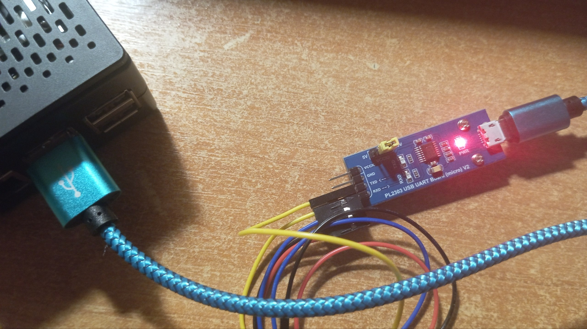
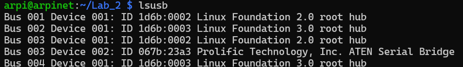
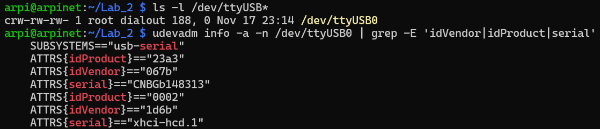
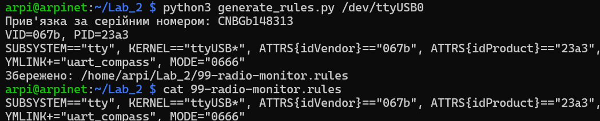
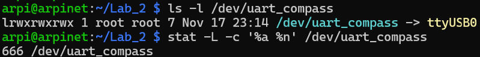
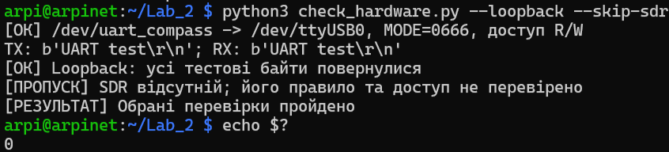
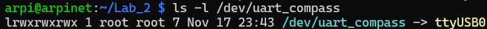
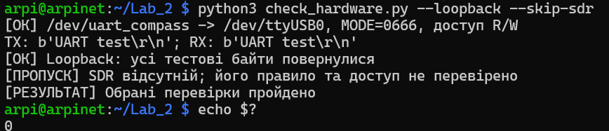

# Управління USB-пристроями та правила udev

## Мета роботи

Опанувати ідентифікацію USB-пристроїв і створення правил udev для призначення постійних імен та налаштування прав доступу. Перевірити роботу USB-UART адаптера за допомогою Python.

## Опис системи та реалізація

Система складається з Raspberry Pi 5 і USB-UART адаптера PL2303. Скрипт `generate_rules.py` визначає VID/PID адаптера та формує правило `99-radio-monitor.rules`. Правило додає постійне ім'я `/dev/uart_compass` і права `0666` для роботи без sudo. Прив'язка виконується за серійним номером, а за його відсутності — за USB-портом.

Скрипт `check_hardware.py` перевіряє посилання, права доступу й передачу байтів у режимі loopback: передані через TX дані повертаються через RX. SDR-приймач відсутній, тому його перевірка пропускається через `--skip-sdr`; файл `blacklist-sdr.conf` не встановлюється.

## Підключення

PL2303 підключено до USB-порту Raspberry Pi. TX і RX самого адаптера з'єднано між собою. GPIO Raspberry Pi не використовуються. Перемичка вибору напруги залишається в положенні 3.3 V, для TX–RX використовується окрема перемичка.



## Виконання та перевірка

**1. Підготовка й ідентифікація адаптера**

Усі команди виконуємо на Raspberry Pi. Переходимо до папки лабораторної та встановлюємо залежності:

```bash
cd ~/Lab_2
sudo apt update
sudo apt install python3-serial usbutils
```

Переглядаємо підключені USB-пристрої та знаходимо PL2303:

```bash
lsusb
```



Перевіряємо ім'я USB-UART порту та переглядаємо ідентифікатори адаптера:

```bash
ls -l /dev/ttyUSB*
udevadm info -a -n /dev/ttyUSB0 | grep -E 'idVendor|idProduct|serial'
```




**2. Створення та застосування правила udev**

Створюємо правило за ідентифікаторами підключеного адаптера та переглядаємо вміст файла:

```bash
python3 generate_rules.py /dev/ttyUSB0
cat 99-radio-monitor.rules
```




Копіюємо файл у системний каталог правил udev:

```bash
sudo install -m 644 99-radio-monitor.rules /etc/udev/rules.d/99-radio-monitor.rules
```

Даємо службі udev команду перечитати файли правил:

```bash
sudo udevadm control --reload-rules
```

Повторно створюємо події додавання для наявних пристроїв підсистеми tty. Udev обробляє їх за оновленими правилами, тому для відповідного адаптера створюється посилання та встановлюються права без фізичного перепідключення USB:

```bash
sudo udevadm trigger --action=add --subsystem-match=tty
```

Чекаємо, поки udev завершить обробку поточної черги подій:

```bash
sudo udevadm settle
```

Перевіряємо створене посилання та права пристрою, на який воно вказує:

```bash
ls -l /dev/uart_compass
stat -L -c '%a %n' /dev/uart_compass
```



**3. Перевірка передачі даних без sudo**

Запускаємо loopback-тест без sudo та перевіряємо код завершення:

```bash
python3 check_hardware.py --loopback --skip-sdr
echo $?
```



**4. Перевірка після перепідключення**

Від'єднуємо PL2303 від USB та підключаємо до того самого USB-порту. Очікуємо завершення обробки подій udev і перевіряємо, чи посилання створилося повторно:

```bash
sudo udevadm settle
ls -l /dev/uart_compass
```



Повторно перевіряємо передачу байтів без перевстановлення правила:

```bash
python3 check_hardware.py --loopback --skip-sdr
echo $?
```


