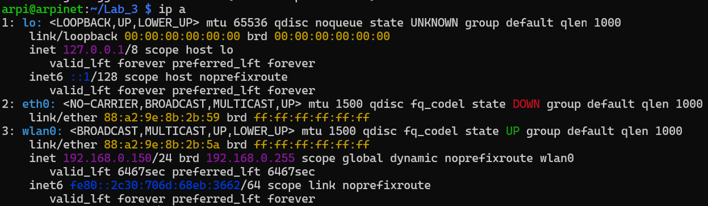
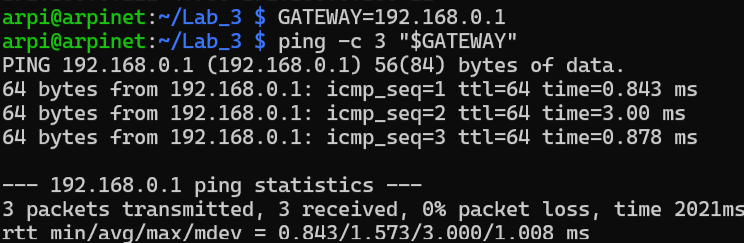
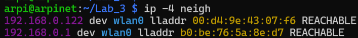
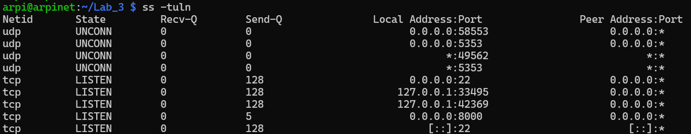
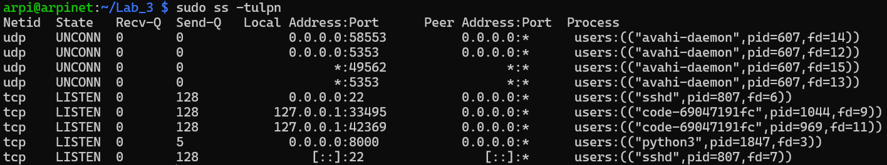
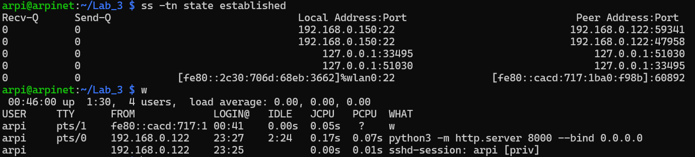
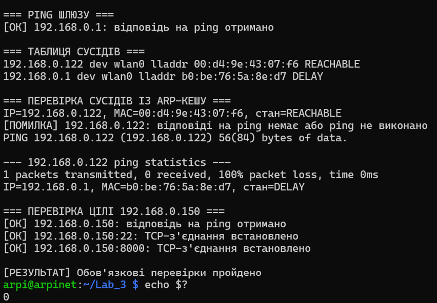
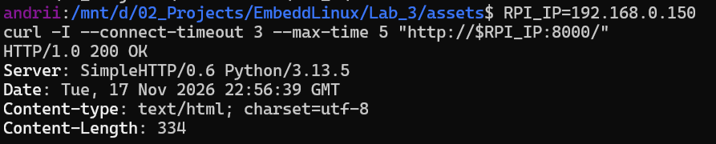
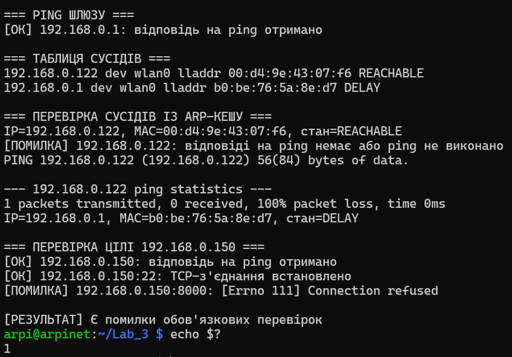

# Лабораторна робота №3 — Діагностика мережевих інтерфейсів і сервісів Linux

**Студент:** Чухлєб Андрій, РЕ-31

**Тема:** Налаштування та автоматизоване тестування мережевих інтерфейсів і сервісів вбудованої системи Linux.

## Мета роботи

Опанувати інструменти діагностики IP-адресації, маршрутів, сусідніх пристроїв і відкритих портів у Linux. Автоматизувати перевірку доступності шлюзу, хостів і TCP-сервісів за допомогою Python.

## Структура репозиторію

| Файл або каталог | Призначення |
| --- | --- |
| [`network_test.py`](network_test.py) | Виводить дані про мережеві інтерфейси, маршрути й порти та перевіряє доступність вузлів і TCP-сервісів. |
| [`assets/`](assets/) | Скриншоти мережевої діагностики та перевірок. |
| [`README.md`](README.md) | Опис лабораторної, команди розгортання й результати перевірки. |

## Опис системи та реалізація

Raspberry Pi 5 підключена до локальної мережі через Ethernet або Wi-Fi. Комп'ютер із WSL використовується для SSH-доступу до плати. На RPi перевіряються SSH на TCP-порту 22 і тестовий HTTP-сервер Python на TCP-порту 8000.

Скрипт `network_test.py` виконує системні команди через subprocess, показує інтерфейси, маршрути, таблицю сусідів, порти та активні сесії. Шлюз і цільовий пристрій перевіряються через ping, TCP-порти — через socket. Перевірка TCP виконується незалежно від результату ping. Додатково скрипт перевіряє ICMP-доступність сусідів із ARP-кешу, крім записів FAILED та INCOMPLETE.

Статична IP-адреса є опціональною частиною завдання. У цій роботі використовується чинна мережева конфігурація без зміни налаштувань інтерфейсу.

## Підключення та топологія

Комп'ютер і Raspberry Pi підключені до домашнього маршрутизатора. Додаткові модулі, GPIO та PL2303 не використовуються.

Після визначення адрес заповнити таблицю фактичними даними:

| Вузол | IPv4-адреса | Призначення |
| --- | --- | --- |
| Raspberry Pi 5 | 192.168.0.150 | SSH: TCP 22, HTTP: TCP 8000 |
| Маршрутизатор | 192.168.0.1 | Шлюз локальної мережі |
| Комп'ютер / SSH-клієнт | 192.168.0.122 | Віддалене керування платою |

Адреса WSL може відрізнятися від адреси Windows через віртуальну мережу. У таблиці вказується адреса клієнта, яку бачить Raspberry Pi.

## Виконання та перевірка

**1. Підготовка**

Встановлюємо потрібні утиліти:

```bash
cd ~/Lab_3
sudo apt update
sudo apt install python3 iproute2 iputils-ping procps curl
```

**2. Ідентифікація інтерфейсу та шлюзу**

Переглядаємо IP- і MAC-адреси мережевих інтерфейсів. inet — IPv4-адреса з довжиною префікса, link/ether — MAC-адреса:

```bash
ip a
```



Визначаємо шлюз і мережевий інтерфейс за маршрутом default. Адреса шлюзу вказана після via, інтерфейс — після dev:

```bash
ip -4 route show default
```


Переглядаємо адресу SSH-клієнта. Перше поле — IP клієнта, третє — IP плати, через який установлено сеанс:

```bash
echo "$SSH_CONNECTION"
```


**3. Перевірка шлюзу та таблиці сусідів**

Записуємо фактичну адресу шлюзу у змінну та надсилаємо три ICMP-запити:

```bash
GATEWAY=192.168.0.1
ping -c 3 "$GATEWAY"
```



Переглядаємо відомі платі IP- і MAC-адреси сусідів. Після звернення до шлюзу його запис зазвичай присутній у таблиці:

```bash
ip -4 neigh
```


**4. Запуск тестового сервісу й аудит портів**

Запускаємо HTTP-сервер на порту 8000. Він надає файли лише з папки Lab_3. Цей SSH-термінал залишаємо відкритим:

```bash
cd ~/Lab_3
python3 -m http.server 8000 --bind 0.0.0.0
```

У другому терміналі WSL відкриваємо ще один сеанс на Raspberry Pi.

Переглядаємо локальні TCP/UDP-порти. Знаходимо TCP-порти 22 і 8000 у стані LISTEN:

```bash
ss -tuln
```



Визначаємо процеси, які використовують ці порти. Права sudo дозволяють побачити інформацію про процеси інших користувачів:

```bash
sudo ss -tulpn
```



Переглядаємо встановлені TCP-з'єднання й активні сеанси користувачів:

```bash
ss -tn state established
w
```



**5. Автоматизована перевірка**

На Raspberry Pi записуємо її фактичну IPv4-адресу у змінну та запускаємо скрипт без sudo:

```bash
RPI_IP=192.168.0.150
python3 network_test.py --host "$RPI_IP" --ports 22 8000
echo $?
```

Успішний результат: шлюз і ціль відповідають на ping, TCP-з'єднання з портами 22 і 8000 встановлюються, код завершення — 0. Код 1 означає невдалу обов'язкову перевірку, 2 — помилку виконання. Довідкові ping-перевірки інших сусідів не впливають на підсумковий код.



**6. Перевірка доступу з комп'ютера**

У новому терміналі WSL підставляємо IP плати та перевіряємо HTTP-відповідь з іншого пристрою:

```bash
RPI_IP=192.168.0.150
curl -I --connect-timeout 3 --max-time 5 "http://$RPI_IP:8000/"
```



Перевірка власної IP-адреси на RPi не перевіряє зовнішній мережевий шлях. Саме curl із WSL підтверджує доступ до HTTP-сервера з комп'ютера.

**7. Перевірка виявлення недоступного сервісу**

Зупиняємо HTTP-сервер через Ctrl+C у першому SSH-терміналі. У другому SSH-терміналі повторюємо перевірку:

```bash
python3 network_test.py --host "$RPI_IP" --ports 22 8000
echo $?
```

Очікується успішне підключення до SSH, помилка для TCP-порту 8000 та код завершення 1. Якщо сервер запустити знову, повна перевірка має проходити.



## Висновок

Досліджено мережеві інтерфейси, маршрути й таблицю сусідів Raspberry Pi. Створено Python-скрипт для автоматизованої перевірки шлюзу, вузлів і TCP-портів. Доступ до тестового HTTP-сервера перевірено з WSL, а його зупинку використано для перевірки виявлення недоступного порту.
