# Лабораторна робота №4 — Вебсервіс керування частотою та візуалізації спектра

**Студент:** Чухлєб Андрій, РЕ-31

**Тема:** Розгортання вебсервісу для віддаленого керування SDR-приймачем і потокової візуалізації радіоспектра.

## Мета роботи

Опанувати розгортання асинхронного вебсервера FastAPI на Raspberry Pi, передавання даних спектра через WebSocket і створення вебінтерфейсу для керування частотою. Налаштувати автозапуск сервера через systemd.

## Структура репозиторію

| Файл або каталог | Призначення |
| --- | --- |
| [`sdr_web_app.py`](sdr_web_app.py) | Обробляє HTTP-запити, змінює центральну частоту та передає імітований спектр через WebSocket. |
| [`index.html`](index.html) | Вебінтерфейс із полем введення частоти й графіком спектра на canvas. |
| [`requirements.txt`](requirements.txt) | Перелік залежностей Python для вебсервісу. |
| [`sdr_web.service`](sdr_web.service) | Конфігурація автозапуску вебсервісу через systemd. |
| [`assets/`](assets/) | Скриншоти запуску, роботи вебінтерфейсу й перевірки служби. |
| [`README.md`](README.md) | Опис лабораторної, команди розгортання й результати перевірки. |

## Опис системи та реалізація

Raspberry Pi 5 запускає веб-сервер на TCP-порту 8001. Комп'ютер або смартфон у тій самій локальній мережі відкриває сторінку з графіком спектра та формою введення частоти.

Файл `sdr_web_app.py` містить три маршрути: GET `/` повертає `index.html`, POST `/api/frequency` змінює центральну частоту, WebSocket `/ws/spectrum` передає 128 амплітуд приблизно кожні 0.1 с. Браузер малює спектр на canvas без перезавантаження сторінки. Частота спільна для всіх клієнтів, тому сервер запускається в одному процесі.

Спектр генерується програмно, як дозволено в завданні. SDR не підключено, реальні радіодані та FFT не обчислюються. Імітується сигнал на 100.5 МГц у смузі огляду 2 МГц; амплітуди подано в умовних одиницях. Після зміни центральної частоти пік зміщується на графіку або виходить за межі смуги. Межі введення 1–2000 МГц вибрано для навчального прикладу.

## Підключення та топологія

Raspberry Pi і комп'ютер підключені до локальної мережі. Для перевірки зі смартфона використовується та сама мережа Wi-Fi. GPIO та PL2303 не використовуються.

| Вузол / сервіс | Адреса | Призначення |
| --- | --- | --- |
| Raspberry Pi 5 | 192.168.0.150 | Веб-сервер і генерація спектра |
| Маршрутизатор | 192.168.0.1 | Шлюз локальної мережі |
| HTTP і WebSocket | TCP 8001 | Сторінка, керування частотою, потік спектра |
| SSH | TCP 22 | Розгортання й адміністрування |

## Виконання та перевірка

**1. Підготовка середовища**

На Raspberry Pi встановлюємо засоби створення віртуального середовища:

```bash
cd ~/Lab_4
sudo apt update
sudo apt install python3-venv curl
```

Створюємо окреме Python-середовище для лабораторної та встановлюємо залежності з файла:

```bash
python3 -m venv .venv
.venv/bin/python -m pip install -r requirements.txt
```

**2. Перевірка мережі**

Переглядаємо адресу плати та шлюз. IP плати знаходимо в inet активного інтерфейсу, адресу шлюзу — після via:

```bash
ip a
ip -4 route show default
```

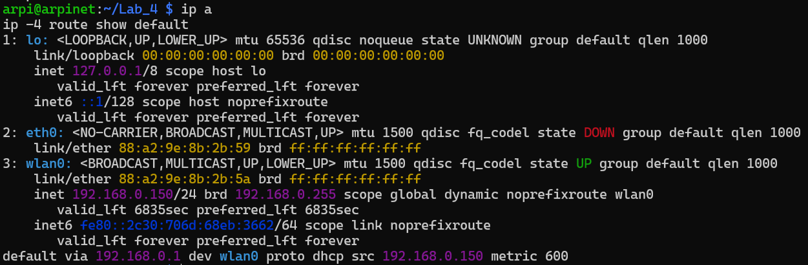

Надсилаємо запити шлюзу й переглядаємо його запис у таблиці сусідів:

```bash
ping -c 3 192.168.0.1
ip -4 neigh
```

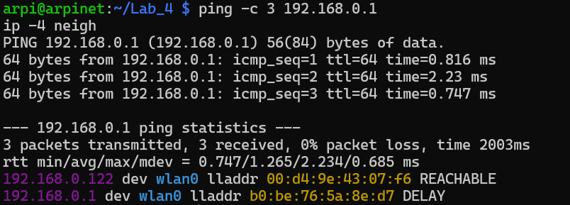

**3. Ручний запуск сервера**

Запускаємо сервер у першому SSH-терміналі. Цей термінал залишаємо відкритим до встановлення systemd-сервісу в пункті 6:

```bash
cd ~/Lab_4
.venv/bin/python sdr_web_app.py
```

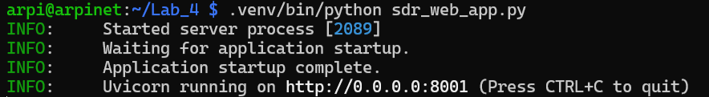

У другому терміналі WSL відкриваємо ще один SSH-сеанс і переходимо до лабораторної:

```bash
ssh pi
cd ~/Lab_4
```

Перевіряємо, що порт 8001 прослуховується, та переглядаємо процес сервера:

```bash
sudo ss -ltnp 'sport = :8001'
```

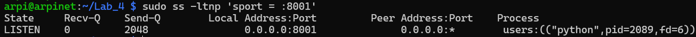

**4. Перевірка інтерфейсу та потоку спектра**

На комп'ютері або смартфоні відкриваємо адресу в браузері:

```text
http://192.168.0.150:8001/
```

На сторінці є графік, позначка режиму імітації та статус активного потоку. За частоти 100.5 МГц пік розташований приблизно посередині. Коли ввести 101 МГц: показана центральна частота змінюється, пік переходить ліворуч. Повертаємо 100.5 МГц — пік знову в центрі.

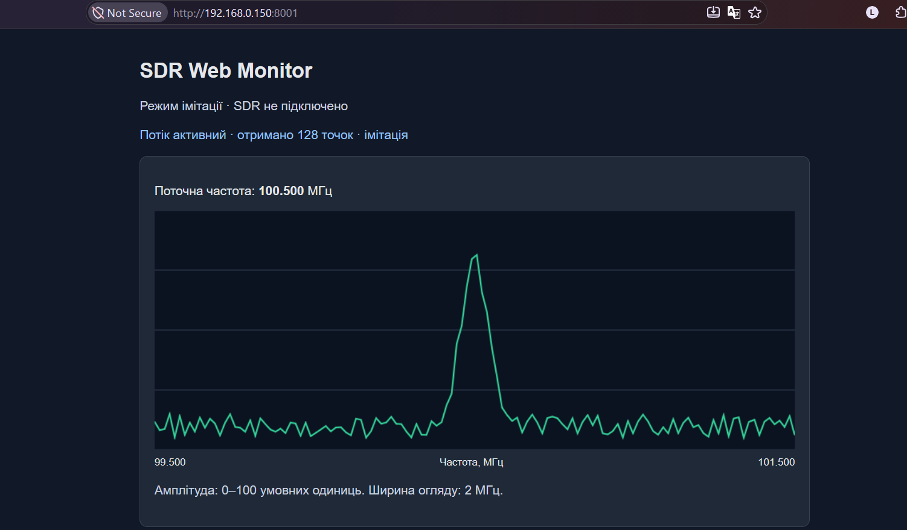

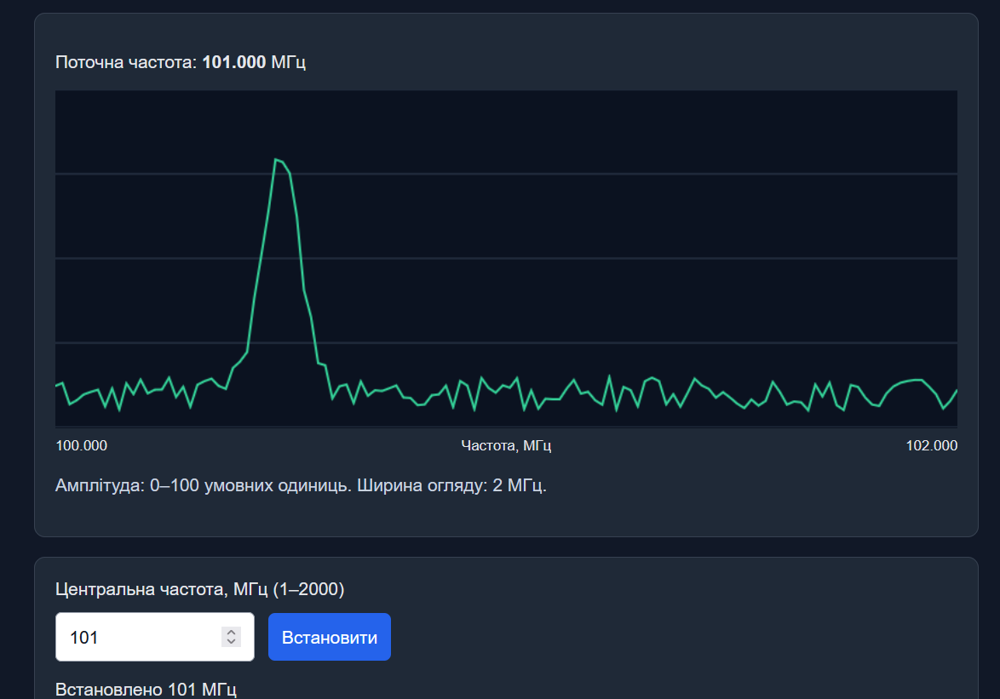

Для перевірки потоку на ПК відкриваємо засоби розробника браузера (F12), розділ Network, фільтр WS і з'єднання `/ws/spectrum`. У Messages або Frames мають надходити JSON-повідомлення з frequency_mhz, span_mhz і масивом fft_data. Якщо запиту немає, оновлюємо сторінку з відкритим Network.

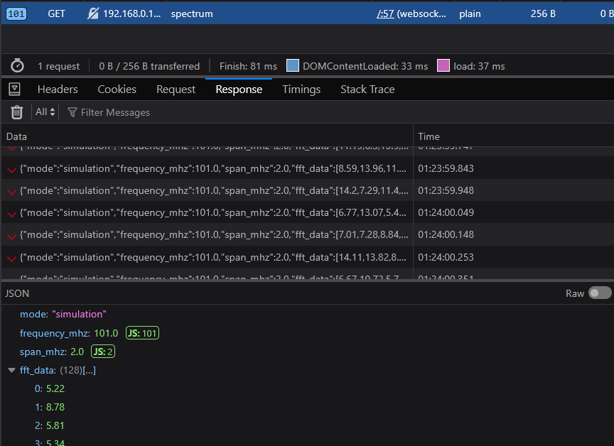

**5. Перевірка HTTP API**

У другому SSH-терміналі отримуємо сторінку GET-запитом. Команда виведе HTTP-заголовки й HTML:

```bash
curl -i http://127.0.0.1:8001/
```
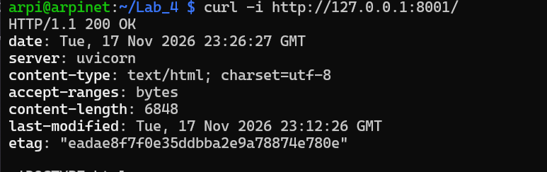

Надсилаємо нову частоту як JSON у POST-запиті. У відповіді очікуються status=ok та frequency_mhz=101:

```bash
curl -i -X POST http://127.0.0.1:8001/api/frequency -H 'Content-Type: application/json' -d '{"frequency_mhz":101}'
```

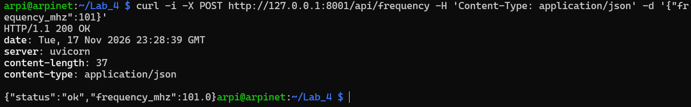

Перевіряємо відхилення частоти поза дозволеними межами. Очікується HTTP 422, попередня частота залишається без змін:

```bash
curl -i -X POST http://127.0.0.1:8001/api/frequency -H 'Content-Type: application/json' -d '{"frequency_mhz":-1}'
```

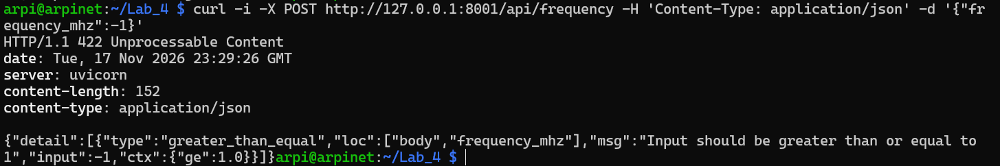

**6. Налаштування автозапуску**

У першому SSH-терміналі зупиняємо ручний сервер через Ctrl+C. До встановлення служби перевіряємо в другому SSH-терміналі, що порт звільнився:

```bash
ss -ltn 'sport = :8001'
```

Копіюємо файл служби в системний каталог systemd:

```bash
sudo install -m 644 sdr_web.service /etc/systemd/system/sdr_web.service
```

Перечитуємо файли служб, щоб systemd побачив нову конфігурацію:

```bash
sudo systemctl daemon-reload
```

Вмикаємо автозапуск при завантаженні системи та одразу запускаємо службу:

```bash
sudo systemctl enable --now sdr_web.service
```

Перевіряємо автозапуск і поточний стан:

```bash
systemctl is-enabled sdr_web.service
systemctl status sdr_web.service --no-pager
```

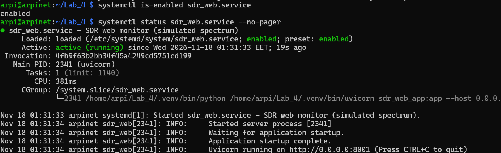

Переглядаємо останні повідомлення служби та перевіряємо HTTP-відповідь:

```bash
journalctl -u sdr_web.service -n 20 --no-pager
curl -i http://127.0.0.1:8001/api/frequency -H 'Content-Type: application/json' -d '{"frequency_mhz":100.5}'
```

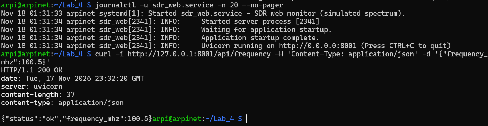

**7. Перевірка після перезавантаження**

Перезавантажуємо Raspberry Pi; SSH-сеанси при цьому закриються:

```bash
sudo reboot
```

Після завантаження плати повторно підключаємося та перевіряємо службу:

```bash
systemctl status sdr_web.service --no-pager
```
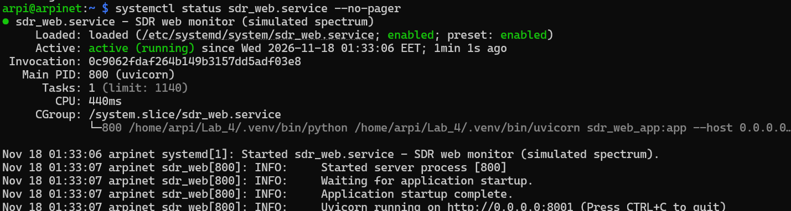

Оновлюємо сторінку `http://192.168.0.150:8001/` у браузері. Графік працює без ручного запуску Python. Після перезапуску початкова частота — 100.5 МГц.

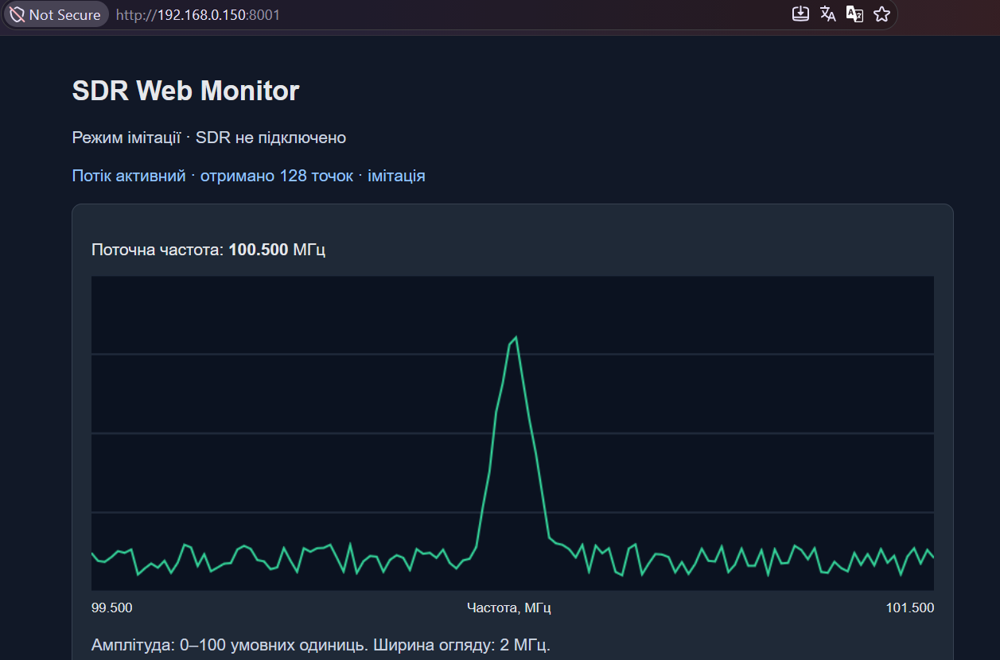

## Висновок

Розгорнуто вебсервіс FastAPI з REST-інтерфейсом зміни центральної частоти та потоком імітованого спектра через WebSocket. Створено вебсторінку для керування частотою й перегляду графіка. Перевірено роботу сервісу в браузері та його автозапуск після перезавантаження Raspberry Pi.
