# Безпечний віддалений доступ через SSH і WireGuard

## Мета роботи

Опанувати автентифікацію SSH за ключами Ed25519, локальне перенаправлення портів і налаштування WireGuard. Обмежити прямий доступ до вебпанелі мережевим екраном та перевірити роботу зашифрованих каналів.

## Опис системи та реалізація

Використовується вебпанель лабораторної 4 на Raspberry Pi. Її порт — 8001; Через SSH-тунель панель доступна на клієнті за адресою `http://127.0.0.1:8888/`, через WireGuard — `http://10.77.0.1:8001/`. Через той самий канал передається й WebSocket-потік спектра.

Файл `sdr-security.conf` вимикає парольний вхід і root-доступ та дозволяє локальне перенаправлення до панелі. Скрипт `ssh_tunnel.sh` запускає тунель із клієнта. Скрипт `generate_wireguard.py` створює окремі пари ключів і конфігурації для RPi та клієнта. UFW дозволяє доступ до панелі через wg0 і блокує прямі підключення через інші мережеві інтерфейси. Loopback залишається доступним для SSH-перенаправлення.

## Підключення та топологія

Додаткове обладнання не потрібне. Raspberry Pi і комп'ютер підключені до маршрутизатора; WSL використовується як SSH- і WireGuard-клієнт.

| Вузол / канал | Адреса | Призначення |
| --- | --- | --- |
| Raspberry Pi | 192.168.0.150 | SSH: TCP 22, WireGuard: UDP 51820 |
| Вебпанель RPi | TCP 8001 | FastAPI з лабораторної 4 |
| Локальний SSH-тунель у WSL | 127.0.0.1:8888 | Доступ до панелі через SSH |
| RPi у WireGuard | 10.77.0.1 | Серверний інтерфейс wg0 |
| Клієнт у WireGuard | 10.77.0.2 | Клієнтський інтерфейс wg0 |


## Виконання та перевірка

**1. Підготовка**

На Raspberry Pi встановлюємо потрібні пакети й перевіряємо службу вебпанелі:

```bash
cd ~/Lab_5
sudo apt update
sudo apt install openssh-server wireguard-tools ufw python3 curl
systemctl status sdr_web.service --no-pager
```

Перевіряємо панель із самої плати:

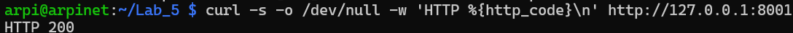

Отримуємо HTTP 200

**2. Створення SSH-ключа**

У новому терміналі WSL створюємо окремий ключ Ed25519. Якщо файл із таким ім'ям уже є, повторно ключ не генеруємо та не перезаписуємо:

```bash
ssh-keygen -t ed25519 -f ~/.ssh/id_ed25519_lab5 -C 'embedded-linux-lab5'
```

Парольна фраза захищає приватний ключ. Для використання ключа без повторного введення фрази в цьому WSL-сеансі запускаємо агент і додаємо ключ:

```bash
eval "$(ssh-agent -s)"
ssh-add ~/.ssh/id_ed25519_lab5
```

Копіюємо лише відкритий ключ на Raspberry Pi. На цьому етапі вводимо пароль користувача arpi:

```bash
ssh-copy-id -i ~/.ssh/id_ed25519_lab5.pub arpi@192.168.0.150
```
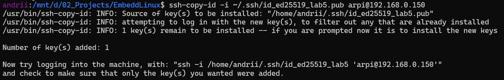

Перевіряємо нове підключення, дозволяючи тільки автентифікацію відкритим ключем. Очікується ім'я arpi без запиту пароля облікового запису:

```bash
ssh -i ~/.ssh/id_ed25519_lab5 -o IdentitiesOnly=yes -o PreferredAuthentications=publickey -o PasswordAuthentication=no -o KbdInteractiveAuthentication=no arpi@192.168.0.150 whoami
```

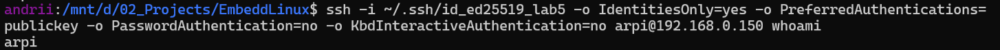

Щоб звична команда `ssh pi` також використовувала новий ключ, у WSL відкриваємо `~/.ssh/config` і додаємо IdentityFile до наявного блока Host pi. Приклад блока (інші потрібні налаштування свого підключення зберігаємо):

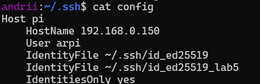

Перевіряємо скорочене підключення:

```bash
ssh -o PasswordAuthentication=no -o KbdInteractiveAuthentication=no pi whoami
```
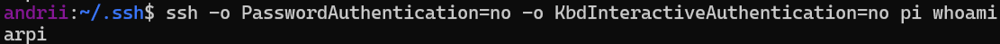

**3. Налаштування SSH-сервера**

Залишаємо поточний SSH-сеанс відкритим, а нові підключення перевіряємо в іншому терміналі.

На Raspberry Pi зберігаємо резервну копію основної SSH-конфігурації та переглядаємо файл лабораторної:

```bash
sudo cp -a /etc/ssh/sshd_config /etc/ssh/sshd_config.lab5-backup
cat ~/Lab_5/sdr-security.conf
```

Установлюємо фрагмент конфігурації SSH:

```bash
sudo install -m 644 ~/Lab_5/sdr-security.conf /etc/ssh/sshd_config.d/sdr-security.conf
```
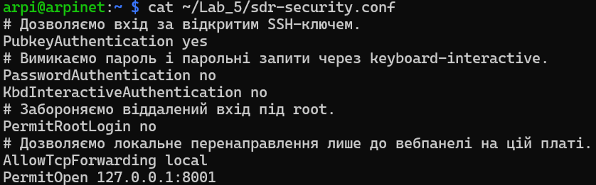

Перевіряємо синтаксис. За успіху sshd -t не виводить повідомлень і повертає 0:

```bash
sudo /usr/sbin/sshd -t
echo $?
```

Переглядаємо ефективні параметри, які сервер використає після перечитування конфігурації:

```bash
sudo /usr/sbin/sshd -T | grep -E '^(passwordauthentication|kbdinteractiveauthentication|permitrootlogin|pubkeyauthentication|allowtcpforwarding|permitopen) '
```

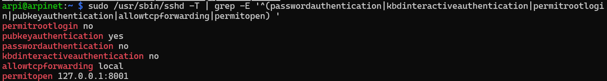

Перечитуємо налаштування SSH без зупинки поточного сеансу:

```bash
sudo systemctl reload ssh
```

У WSL повторюємо підключення за ключем із пункту 2. Потім перевіряємо, що парольний вхід відхиляється:

```bash
ssh -o PubkeyAuthentication=no -o PreferredAuthentications=password arpi@192.168.0.150 whoami
```

Відбувається відмова без запиту пароля:

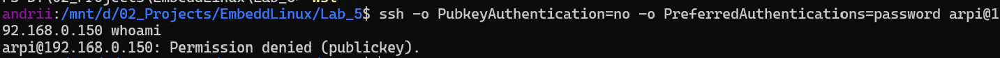

Для повернення попереднього стану з відкритого сеансу можна вилучити саме доданий фрагмент, перевірити синтаксис і перечитати службу. Якщо змінювався основний sshd_config, відновлюємо його з резервної копії.

**4. SSH-тунель**

У WSL з кореня проєкту запускаємо скрипт тунелю. Цей термінал залишаємо відкритим:

```bash
bash Lab_5/ssh_tunnel.sh
```
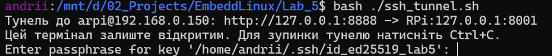

Скрипт запускає таке перенаправлення: порт 8888 на loopback клієнта → SSH → порт 8001 на loopback RPi. Еквівалентна команда:

```bash
ssh -i ~/.ssh/id_ed25519_lab5 -o IdentitiesOnly=yes -o ExitOnForwardFailure=yes -L 127.0.0.1:8888:127.0.0.1:8001 -N arpi@192.168.0.150
```

У другому терміналі WSL перевіряємо сторінку через тунель, не підключаючись через ssh до RPi:

```bash
curl --noproxy '*' -s -o /dev/null -w 'HTTP %{http_code}\n' http://127.0.0.1:8888/
```
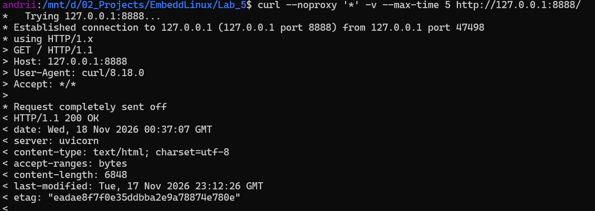

У браузері комп'ютера відкриваємо `http://localhost:8888/`. Графік і зміна частоти працюють.

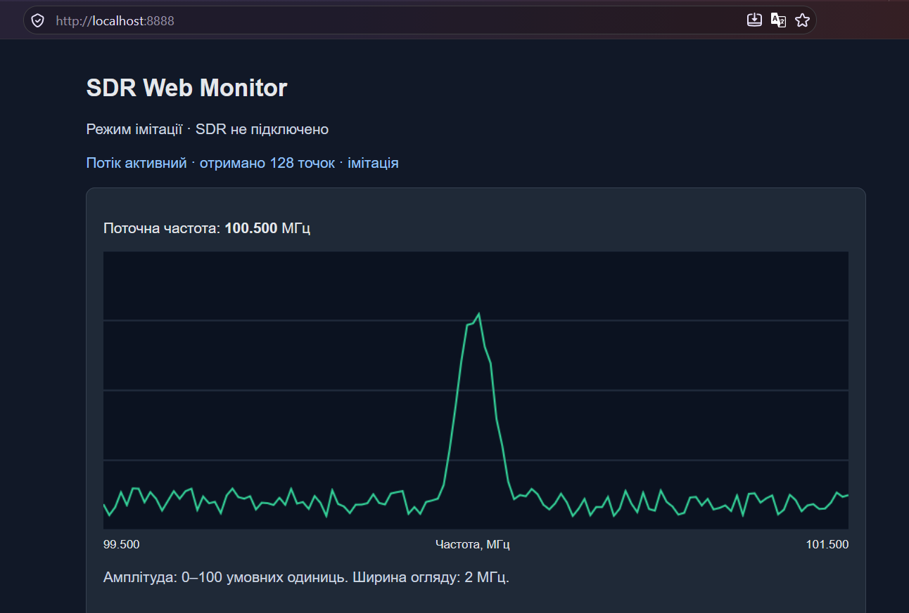

**5. Налаштування фаєрвола**

На Raspberry Pi переглядаємо наявні правила. UFW не скидаємо, наявні правила інших робіт зберігаємо:

```bash
sudo ufw status numbered
```
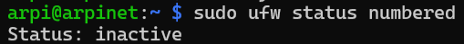
Як бачимо наразі він вимкнений.

Дозволяємо SSH до ввімкнення фаєрвола, щоб зберегти віддалений доступ. Для цієї плати використовується стандартний порт 22:

```bash
sudo ufw allow 22/tcp
```

Дозволяємо UDP-порт майбутнього WireGuard-тунелю:

```bash
sudo ufw insert 1 allow 51820/udp
```

Додаємо дозвіл доступу клієнта WireGuard до VPN-адреси панелі через інтерфейс wg0:

```bash
sudo ufw insert 1 allow in on wg0 proto tcp from 10.77.0.2 to 10.77.0.1 port 8001
```

Наступним правилом забороняємо прямий доступ до порту 8001. Дозвіл wg0 стоїть вище й має пріоритет. Loopback обробляється стандартними початковими правилами UFW:

```bash
sudo ufw insert 2 deny 8001/tcp
```

Вмикаємо UFW та переглядаємо остаточні правила. Команди вставлення правил виконуємо один раз; при повторній роботі спочатку перевіряємо порядок через status numbered:

```bash
sudo ufw enable
sudo ufw status verbose
sudo ufw status numbered
```

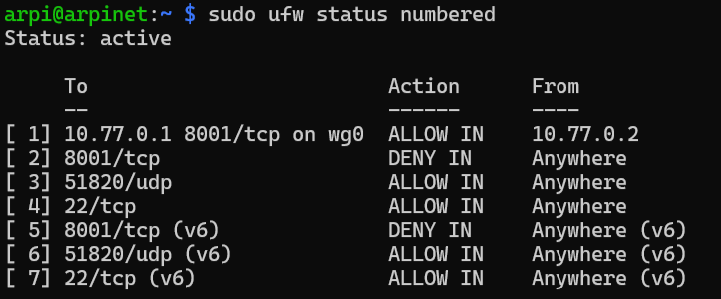

У WSL перевіряємо обидва шляхи. Прямий запит має завершитися помилкою/таймаутом, а запит через відкритий SSH-тунель — повернути HTTP 200:

```bash
curl --noproxy '*' --connect-timeout 3 --max-time 5 http://192.168.0.150:8001/
curl --noproxy '*' -s -o /dev/null -w 'HTTP %{http_code}\n' http://127.0.0.1:8888/
```

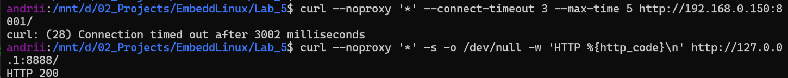

**6. Створення WireGuard-конфігурацій**

На Raspberry Pi генеруємо конфігурації. Скрипт не потребує sudo, зберігає файли з приватними ключами поза репозиторієм і не перезаписує наявний каталог:

```bash
cd ~/Lab_5
python3 generate_wireguard.py --endpoint 192.168.0.150
```
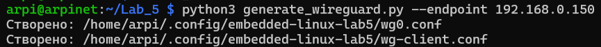

Копіюємо серверну конфігурацію до каталогу WireGuard з доступом тільки root:

```bash
sudo install -d -m 700 /etc/wireguard
sudo install -m 600 ~/.config/embedded-linux-lab5/wg0.conf /etc/wireguard/wg0.conf
```

Запускаємо серверний інтерфейс і вмикаємо його автозапуск:

```bash
sudo systemctl enable --now wg-quick@wg0
ip -4 addr show wg0
```

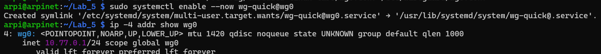

У WSL встановлюємо клієнтські утиліти, створюємо приватний каталог і завантажуємо лише клієнтську конфігурацію через зашифроване SSH-з'єднання:

```bash
sudo apt update
sudo apt install wireguard-tools
install -d -m 700 ~/.config/embedded-linux-lab5
scp -i ~/.ssh/id_ed25519_lab5 -o IdentitiesOnly=yes arpi@192.168.0.150:.config/embedded-linux-lab5/wg-client.conf ~/.config/embedded-linux-lab5/wg-client.conf
chmod 600 ~/.config/embedded-linux-lab5/wg-client.conf
```

Встановлюємо клієнтську конфігурацію й запускаємо wg0 у WSL:

```bash
sudo install -d -m 700 /etc/wireguard
sudo install -m 600 ~/.config/embedded-linux-lab5/wg-client.conf /etc/wireguard/wg0.conf
sudo wg-quick up wg0
```
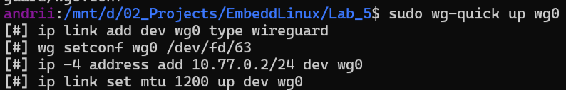


**7. Перевірка WireGuard**

У WSL надсилаємо запити до VPN-адреси Raspberry Pi, переглядаємо handshake та відкриваємо панель:

```bash
ping -c 3 10.77.0.1
sudo wg show wg0
curl --noproxy '*' -s -o /dev/null -w 'HTTP %{http_code}\n' http://10.77.0.1:8001/
```

У виводі wg очікуємо latest handshake і ненульові лічильники transfer, у відповіді curl — HTTP 200. Наявності самого інтерфейсу недостатньо для підтвердження тунелю. Якщо UFW блокує ICMP у конкретній конфігурації, handshake та успішний HTTP-запит окремо підтверджують VPN-доступ до панелі.

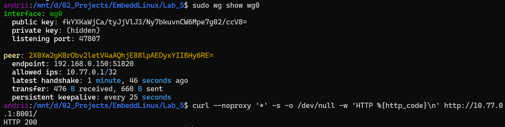

На Raspberry Pi перевіряємо серверну сторону:

```bash
sudo wg show wg0
systemctl status wg-quick@wg0 --no-pager
```

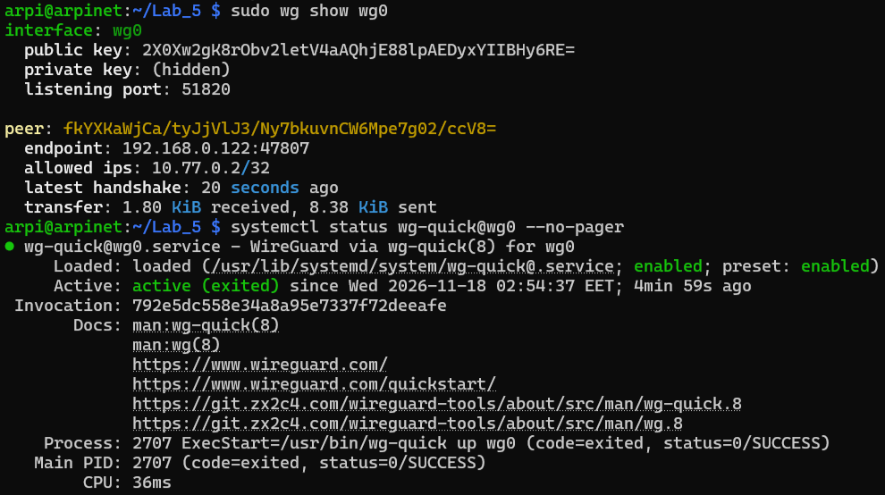


**8. Завершення**

Для зупинки SSH-тунелю натискаємо Ctrl+C у терміналі, де запущено ssh_tunnel.sh. Вебпанель і WireGuard при цьому не зупиняються. Клієнтський VPN у WSL вимикаємо окремо:

```bash
sudo wg-quick down wg0
```
