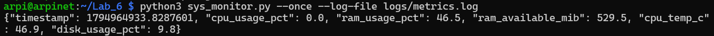
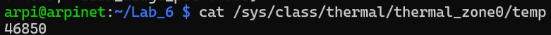
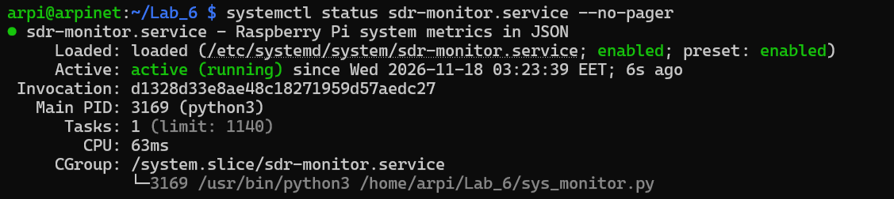
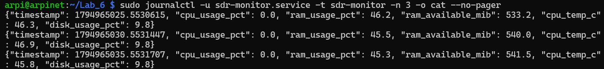
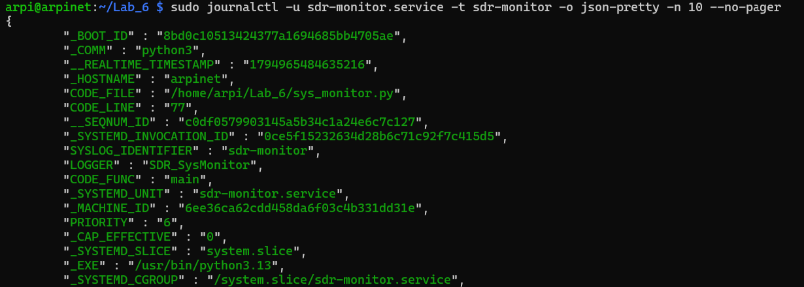
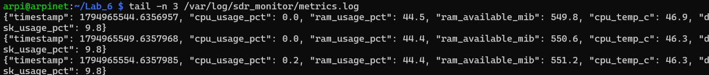
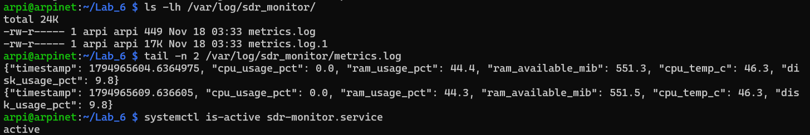
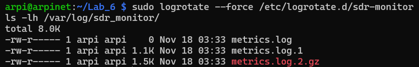
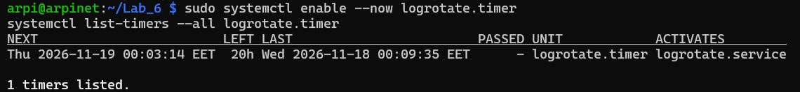

# Лабораторна робота 6. Логування та моніторинг системних ресурсів Raspberry Pi

## Мета роботи

Реалізувати періодичний збір показників CPU, температури й оперативної пам'яті на Raspberry Pi. Налаштувати фоновий запуск через systemd, запис метрик у JSON і ротацію файлового журналу.

## Опис системи та реалізація

Скрипт `sys_monitor.py` кожні 5 секунд збирає завантаження CPU, використання та доступний обсяг RAM, температуру SoC і заповнення кореневої файлової системи. Для CPU, RAM і диска використовується psutil, а температура зчитується з файла Linux.

Служба `sdr-monitor.service` запускає скрипт у фоні. Кожне вимірювання надходить до journald і в окремий текстовий файл `metrics.log`. Для цього файла налаштовано щоденну ротацію, збереження до семи архівів і стиснення gzip. Поріг 10 MiB перевіряється під час запуску logrotate.

## Підключення та обладнання

Комп'ютер із WSL і Raspberry Pi 5 підключені до локальної мережі. Керуємо платою через SSH. Для роботи достатньо вбудованого датчика температури Raspberry Pi.

## Виконання та перевірка

**1. Підготовка**

Встановлюємо Python, бібліотеки для збору метрик і запису в journald та утиліту logrotate:

```bash
cd ~/Lab_6
sudo apt update
sudo apt install python3 python3-psutil python3-systemd logrotate
```

**2. Перевірка збирання метрик**

Створюємо каталог для тестового журналу й запускаємо один цикл вимірювання. Програма виведе один запис JSON і завершиться:

```bash
mkdir -p logs
python3 sys_monitor.py --once --log-file logs/metrics.log
```



Переглядаємо значення датчика для порівняння з полем `cpu_temp_c`:

```bash
cat /sys/class/thermal/thermal_zone0/temp
```



Що відповідає 46,85 °C:

**3. Запуск фонової служби**

Копіюємо файл служби під назвою `sdr-monitor.service`. Окрема назва дозволяє використовувати її разом із `monitor.service` з першої лабораторної:

```bash
sudo install -m 644 monitor.service /etc/systemd/system/sdr-monitor.service
```

Перечитуємо описи служб після додавання нового файла:

```bash
sudo systemctl daemon-reload
```

Запускаємо моніторинг і вмикаємо його автозапуск. Під час старту systemd створить каталог `/var/log/sdr_monitor`:

```bash
sudo systemctl enable --now sdr-monitor.service
```

Перевіряємо, чи служба працює:

```bash
systemctl status sdr-monitor.service --no-pager
```



**4. Перегляд журналів**

Чекаємо приблизно 15 секунд і виводимо останні три повідомлення служби. Режим `-o cat` показує текст кожного повідомлення:

```bash
sudo journalctl -u sdr-monitor.service -t sdr-monitor -n 3 -o cat --no-pager
```



Переглядаємо до десяти записів разом із полями, які додає journald. Метрики містяться в полі `MESSAGE`:

```bash
sudo journalctl -u sdr-monitor.service -t sdr-monitor -o json-pretty -n 10 --no-pager
```



Перевіряємо останні три записи в текстовому журналі:

```bash
tail -n 3 /var/log/sdr_monitor/metrics.log
```



**5. Налаштування та перевірка ротації**

Копіюємо конфігурацію в каталог правил logrotate:

```bash
sudo install -m 644 sdr-monitor /etc/logrotate.d/sdr-monitor
```

Перевіряємо правило в режимі діагностики. Logrotate покаже, як обробить журнал, без зміни файлів:

```bash
sudo logrotate --debug /etc/logrotate.d/sdr-monitor
```

Примусово запускаємо ротацію, щоб перевірити її одразу:

```bash
sudo logrotate --force --verbose /etc/logrotate.d/sdr-monitor
```

Чекаємо 10 секунд і перевіряємо, що старий журнал став архівом `metrics.log.1`, а служба пише в новий файл:

```bash
ls -lh /var/log/sdr_monitor/
tail -n 2 /var/log/sdr_monitor/metrics.log
systemctl is-active sdr-monitor.service
```



Повторюємо ротацію, коли новий журнал уже містить записи. Через параметр `delaycompress` перший архів стискається саме під час цієї ротації:

```bash
sudo logrotate --force /etc/logrotate.d/sdr-monitor
ls -lh /var/log/sdr_monitor/
```



Вмикаємо штатний таймер logrotate й перевіряємо, коли заплановано наступний запуск:

```bash
sudo systemctl enable --now logrotate.timer
systemctl list-timers --all logrotate.timer
```



**6. Завершення перевірки**

Після виходу з SSH служба продовжить збирати метрики.

## Висновок

Підготовлено програму для періодичного збору метрик Raspberry Pi та запису їх у форматі JSON. Працездатність перевіряється за станом служби, інтервалом між записами та появою нових вимірювань після ротації журналу.
