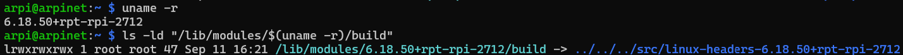
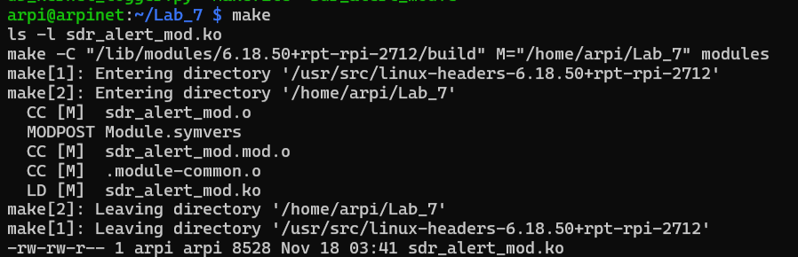
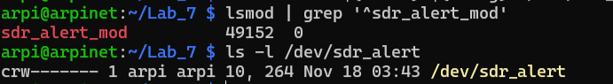
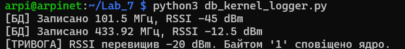
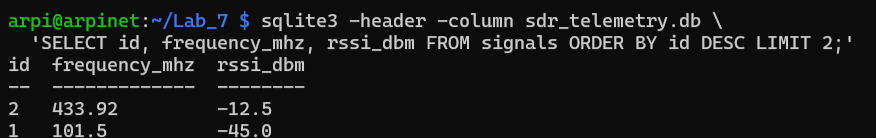
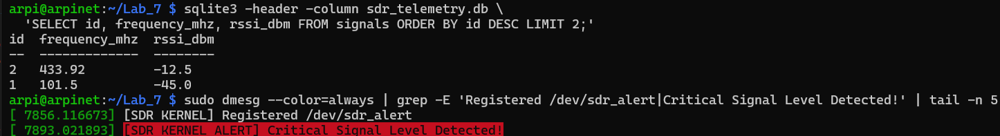

# Лабораторна робота №7 — Телеметрія SDR у SQLite та сповіщення через модуль ядра Linux

**Студент:** Чухлєб Андрій, РЕ-31

**Тема:** Зберігання телеметрії SDR у локальній базі SQLite і розробка модуля ядра Linux для сповіщень.

## Мета роботи

Опанувати зберігання даних радіомоніторингу в SQLite, розробку завантажуваного модуля ядра Linux мовою C і взаємодію Python-скрипта з модулем через символьний пристрій у `/dev`.

## Структура репозиторію

| Файл або каталог | Призначення |
| --- | --- |
| [`db_kernel_logger.py`](db_kernel_logger.py) | Записує тестову телеметрію в SQLite й передає сигнал тривоги через `/dev/sdr_alert`. |
| [`sdr_alert_mod.c`](sdr_alert_mod.c) | Реєструє символьний пристрій і записує повідомлення тривоги до журналу ядра. |
| [`Makefile`](Makefile) | Збирає модуль за допомогою системи збирання ядра та очищає результати збирання. |
| [`sdr_telemetry.db`](sdr_telemetry.db) | Файл SQLite з прикладом збереженої телеметрії. |
| [`assets/`](assets/) | Скриншоти збирання модуля та перевірки бази даних і журналу ядра. |
| [`.gitignore`](.gitignore) | Виключає з Git файли, створені під час збирання модуля. |
| [`README.md`](README.md) | Опис лабораторної, команди розгортання й результати перевірки. |

## Опис системи та реалізація

Скрипт `db_kernel_logger.py` додає до таблиці `signals` час, частоту в МГц і RSSI в dBm. Якщо RSSI перевищує −20 dBm, скрипт записує байт `1` у `/dev/sdr_alert`. Модуль `sdr_alert_mod` обробляє запис і викликає `pr_alert()`. Результат перевіряється через SQLite і `dmesg`.

## Підключення та обладнання

Комп'ютер із WSL і Raspberry Pi 5 підключені до локальної мережі. Плату використовуємо для збирання модуля, запуску скрипта та перевірки журналу. Частоти й RSSI задані в коді для імітації вимірювань. Достатньо Raspberry Pi та SSH-з'єднання.

## Виконання та перевірка

**1. Підготовка**

Встановлюємо компілятор і make через пакет `build-essential`, Python, клієнт SQLite та заголовки саме запущеного ядра:

```bash
cd ~/Lab_7
sudo apt update
sudo apt install build-essential python3 sqlite3 "linux-headers-$(uname -r)"
```

Перевіряємо версію запущеного ядра й шлях до його заголовків. Якщо `apt` не знайшов пакет заголовків, зупиняємося на цьому кроці та перевіряємо, які пакети доступні для версії з `uname -r`:

```bash
uname -r
ls -ld "/lib/modules/$(uname -r)/build"
```



**2. Збирання модуля**

Команда `make` передає вихідний файл системі збирання поточного ядра. Після збирання перевіряємо наявність файла `sdr_alert_mod.ko`:

```bash
make
ls -l sdr_alert_mod.ko
```



**3. Завантаження модуля**

Завантажуємо зібраний модуль у поточне ядро. Він реєструє пристрій, після чого Raspberry Pi OS створює вузол `/dev/sdr_alert`:

```bash
sudo insmod ./sdr_alert_mod.ko
sudo udevadm settle
```

Передаємо вузол поточному користувачу, щоб запускати Python без sudo. Команда `lsmod` показує завантажений модуль, а літера `c` на початку прав у `ls -l` позначає символьний пристрій:

```bash
sudo chown "$(id -u):$(id -g)" /dev/sdr_alert
lsmod | grep '^sdr_alert_mod'
ls -l /dev/sdr_alert
```



**4. Запис сигналів і перевірка тривоги**

Запускаємо програму. Вона додає два тестові вимірювання до бази та передає команду тривоги лише для сигналу −12,5 dBm:

```bash
python3 db_kernel_logger.py
```



Переглядаємо останні два записи з таблиці `signals`. Повторний запуск програми додає ще два рядки:

```bash
sqlite3 -header -column sdr_telemetry.db \
  'SELECT id, frequency_mhz, rssi_dbm FROM signals ORDER BY id DESC LIMIT 2;'
```



Переглядаємо кольоровий вивід журналу ядра. Після рядка про реєстрацію пристрою шукаємо повідомлення `[SDR KERNEL ALERT] Critical Signal Level Detected!`:

```bash
sudo dmesg --color=always | grep -E 'Registered /dev/sdr_alert|Critical Signal Level Detected!' | tail -n 5
```



## Висновок

Реалізовано запис тестових частот і рівнів сигналу в SQLite та передавання тривоги до модуля ядра через `/dev/sdr_alert`. Записи перевірено в таблиці `signals`, а спрацювання тривоги після перевищення порога RSSI підтверджено повідомленням у журналі ядра.
