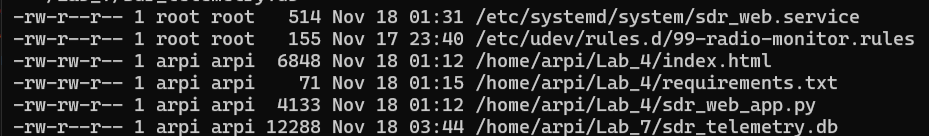
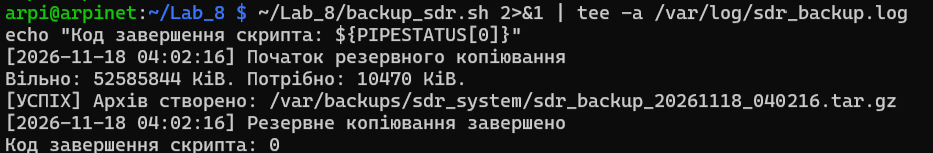
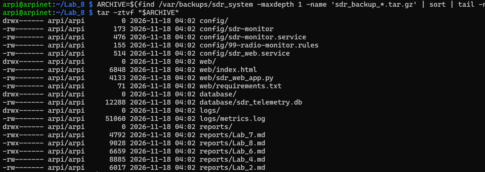
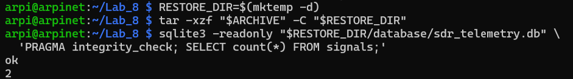
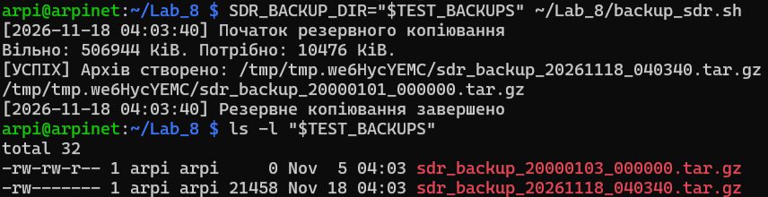
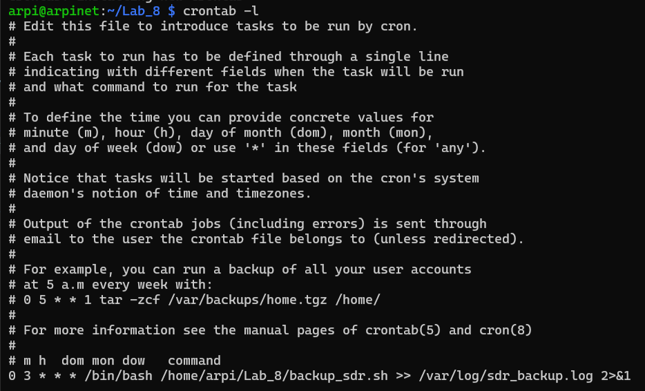
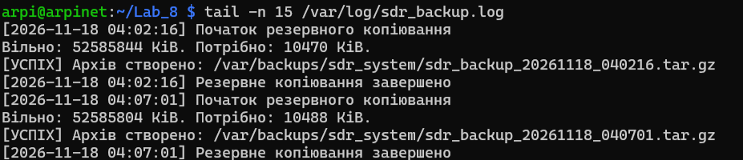
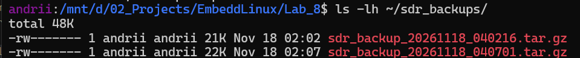

# Лабораторна робота №8 — Резервне копіювання SDR-комплексу

**Студент:** Чухлєб Андрій, РЕ-31

**Тема:** Автоматизоване резервне копіювання конфігурацій, журналів і звітів SDR-комплексу на інший комп’ютер.

## Мета роботи

Опанувати автоматизацію резервного копіювання конфігурацій, бази даних і журналів Linux за допомогою tar, rsync і cron. Перевірити вміст резервної копії та можливість відновлення бази SQLite.

## Структура репозиторію

| Файл або каталог | Призначення |
| --- | --- |
| [`backup_sdr.sh`](backup_sdr.sh) | Перевіряє вільне місце, створює стиснений архів і видаляє застарілі резервні копії. |
| [`assets/`](assets/) | Скриншоти перевірки архіву, відновлення бази, запуску через cron і копіювання на ПК. |
| [`.gitignore`](.gitignore) | Виключає з Git згенеровані архіви та тимчасові файли резервного копіювання. |
| [`README.md`](README.md) | Опис лабораторної, команди розгортання й результати перевірки. |

## Опис системи та реалізація

На Raspberry Pi скрипт `backup_sdr.sh` створює повний архів `sdr_backup_YYYYMMDD_HHMMSS.tar.gz` у `/var/backups/sdr_system`. До архіву входять udev-правило з лабораторної 2, вебсервіс і його конфігурація з лабораторної 4 та база `sdr_telemetry.db` з лабораторної 7. Якщо доступні файли лабораторної 6, скрипт додає її конфігурацію та поточний `metrics.log`. Тексти звітів додаються з наявних на платі файлів README.

Перед записом скрипт перевіряє вільне місце. Після створення архіву він видаляє резервні копії, старші за 14 діб. Cron запускає скрипт щодня о 03:00 за часом Raspberry Pi й записує його вивід у `/var/log/sdr_backup.log`.

## Підключення та топологія

Raspberry Pi 5 і ПК з WSL перебувають у локальній мережі. У WSL використовуємо SSH-псевдонім `pi`. Raspberry Pi створює архів, а ПК забирає його через rsync поверх SSH. Для цієї роботи достатньо файлів із попередніх лабораторних.

## Виконання та перевірка

**1. Підготовка**

На Raspberry Pi встановлюємо cron, rsync та утиліту SQLite. Створюємо каталог для архівів і журнал, доступні користувачу, під яким виконуватиметься завдання cron:

```bash
sudo apt update
sudo apt install cron rsync sqlite3
sudo systemctl enable --now cron
sudo install -d -m 700 -o "$(id -un)" -g "$(id -gn)" /var/backups/sdr_system
sudo touch /var/log/sdr_backup.log
sudo chown "$(id -un):$(id -gn)" /var/log/sdr_backup.log
sudo chmod 600 /var/log/sdr_backup.log
chmod +x ~/Lab_8/backup_sdr.sh
```

Перевіряємо потрібні вихідні файли. Якщо бракує udev-правила або файла служби, встановлюємо їх за відповідними звітами. База створюється після запуску скрипта лабораторної 7 на платі:

```bash
ls -l /etc/udev/rules.d/99-radio-monitor.rules \
  /etc/systemd/system/sdr_web.service \
  ~/Lab_4/{sdr_web_app.py,index.html,requirements.txt} \
  ~/Lab_7/sdr_telemetry.db
```




**2. Ручний запуск і перегляд архіву**

У SSH-сеансі на Raspberry Pi запускаємо скрипт від звичайного користувача. `tee` одночасно показує вивід і дописує його в журнал:

```bash
~/Lab_8/backup_sdr.sh 2>&1 | tee -a /var/log/sdr_backup.log
echo "Код завершення скрипта: ${PIPESTATUS[0]}"
```



Переглядаємо детальний вміст найновішого архіву. Назви всередині відносні, тому архів можна розпакувати в окремий каталог:

```bash
ARCHIVE=$(find /var/backups/sdr_system -maxdepth 1 -name 'sdr_backup_*.tar.gz' | sort | tail -n 1)
tar -ztvf "$ARCHIVE"
```


**3. Перевірка відновлення**

У тому самому SSH-сеансі розпаковуємо архів у новий тимчасовий каталог. Перевіряємо цілісність відновленої бази та кількість записів у таблиці `signals`:

```bash
RESTORE_DIR=$(mktemp -d)
tar -xzf "$ARCHIVE" -C "$RESTORE_DIR"
sqlite3 -readonly "$RESTORE_DIR/database/sdr_telemetry.db" \
  'PRAGMA integrity_check; SELECT count(*) FROM signals;'
```



**4. Перевірка очищення старих копій**

Створюємо два контрольні файли в окремому каталозі. Один має вік 15 діб, інший — 13. Передаємо скрипту тестовий каталог, після чого перевіряємо, що 15-денний файл зник, а 13-денний залишився:

```bash
TEST_BACKUPS=$(mktemp -d)
touch -d '15 days ago' "$TEST_BACKUPS/sdr_backup_20000101_000000.tar.gz"
touch -d '13 days ago' "$TEST_BACKUPS/sdr_backup_20000103_000000.tar.gz"
SDR_BACKUP_DIR="$TEST_BACKUPS" ~/Lab_8/backup_sdr.sh
ls -l "$TEST_BACKUPS"
```



**5. Автозапуск через cron**

На Raspberry Pi перевіряємо місцевий час і відкриваємо crontab свого користувача:

```bash
date '+%F %T %Z'
crontab -e
```

Додаємо один рядок. `0 3 * * *` задає запуск о 03:00 щодня:

```cron
0 3 * * * /bin/bash /home/arpi/Lab_8/backup_sdr.sh >> /var/log/sdr_backup.log 2>&1
```

Щоб дразу перевірити запуск із cron, тимчасово замінюємо `0 3 * * *` на `* * * * *`. Чекаємо до двох хвилин, поки в журналі з'явиться новий запуск, і повертаємо `0 3 * * *`. Перевіряємо збережений розклад і журнал:

```bash
crontab -l
tail -n 15 /var/log/sdr_backup.log
```




**6. Копіювання архіву на ПК**

Повертаємося до термінала WSL. Створюємо каталог на ПК, забираємо готові архіви з Raspberry Pi та переглядаємо локальні копії:

```bash
sudo apt install rsync
mkdir -p ~/sdr_backups
rsync -rtv --include='sdr_backup_*.tar.gz' --exclude='*' \
  pi:/var/backups/sdr_system/ ~/sdr_backups/
ls -lh ~/sdr_backups/
```



## Висновок

Автоматизовано створення резервних копій SDR-комплексу через cron із перевіркою вільного місця та очищенням старих архівів. Перевірено вміст архіву, читання відновленої бази SQLite і копіювання архівів на ПК через rsync.
